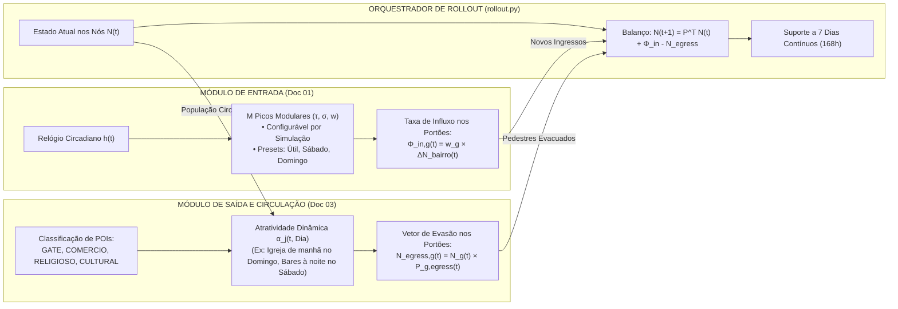

# 📅 RFC-001: Especificação Técnica de Entrada e Saída — Dias da Semana, Picos Modulares e Dinâmica de POIs

**Status:** Aprovado para Implementação pela Equipe  
**Módulos Pertencentes:** 
- **Módulo de Entrada:** Doc 01 (`backend/src/simulation/macro_flow.py`)
- **Módulo de Saída & Circulação:** Doc 03 (`backend/src/simulation/markov_circulation.py`)
- **Orquestrador Temporal:** Motor de Rollout (`backend/src/simulation/rollout.py`)  
**Contexto Institucional:** UNIFACS — Iniciação Científica (IC) — Gêmeo Digital IoT Pelourinho  
**Data:** 31 de Outubro de 2026  

---

## 📌 1. Visão Geral da Arquitetura de Entrada e Saída

A simulação de pedestres do Pelourinho opera como um balanço hidrodinâmico contínuo entre **o que entra** e **o que sai**:

---

## 🚪 PARTE 1: Módulo de Entrada (Doc 01 — `macro_flow.py`)

### 1.1. Picos Modulares Abertos ($M$ Picos Customizáveis)
Em vez de travar o código em uma curva fixa, o cálculo populacional suporta **qualquer quantidade $M$ de picos** definida na simulação:

$$N_{\text{bairro}}(t) = \gamma \cdot \left[ N_{\min} + \sum_{m=1}^{M} A_m \cdot \exp\left( -\frac{(h(t) - \tau_m)^2}{2\sigma_m^2} \right) \right]$$

Onde cada pico $m$ possui três parâmetros configuráveis pelo usuário:
1. $\tau_m$ (tau): Horário de ápice em horas fracionárias (ex: $12.5 = 12\text{h}30$).
2. $\sigma_m$ (sigma): Dispersão temporal em horas (largura da onda).
3. $w_m$ (weight): Peso relativo do pico em $[0.0, 1.0]$, onde a amplitude é $A_m = w_m \cdot (N_{\max} - N_{\min})$.
   * *Ajuste por Simulação:* O operador pode calibrar o peso do pico máximo para $1.0$ caso queira que o pico toque o teto de $N_{\max}$.

### 1.2. Presets Padrão por Dia da Semana
O sistema oferece perfis padrão baseados na realidade de Salvador, permitindo override:

* **Dias Úteis (Segunda a Sexta):**
  * Piso Basal: $N_{\min} = 15$, Lotação de Referência: $N_{\max} = 300$.
  * Pico 1 (Almoço executivo/comércio): $\tau_1 = 12.5\text{h}$, $\sigma_1 = 1.2\text{h}$, $w_1 = 0.65$.
  * Pico 2 (Saída de trabalho / happy hour / turismo): $\tau_2 = 17.2\text{h}$, $\sigma_2 = 1.8\text{h}$, $w_2 = 0.90$.
* **Sábado (Ritmo Comercial & Noite Prolongada):**
  * Piso Basal: $N_{\min} = 25$, Lotação de Referência: $N_{\max} = 420$.
  * Pico 1 (Feira e compras na Baixa dos Sapateiros): $\tau_1 = 10.5\text{h}$, $\sigma_1 = 1.5\text{h}$, $w_1 = 0.50$.
  * Pico 2 (Tarde turística e mirantes): $\tau_2 = 16.0\text{h}$, $\sigma_2 = 1.8\text{h}$, $w_2 = 0.75$.
  * Pico 3 (Noite cultural, bares e largos com música): $\tau_3 = 21.5\text{h}$, $\sigma_3 = 2.2\text{h}$, $w_3 = 0.95$.
* **Domingo (Missas & Contemplação Familiar):**
  * Piso Basal: $N_{\min} = 10$, Lotação de Referência: $N_{\max} = 320$.
  * Pico 1 (Missa cantada no Rosário dos Pretos / São Francisco): $\tau_1 = 10.0\text{h}$, $\sigma_1 = 1.2\text{h}$, $w_1 = 0.70$.
  * Pico 2 (Passeio da tarde / Pôr do sol na Sé): $\tau_2 = 16.0\text{h}$, $\sigma_2 = 1.5\text{h}$, $w_2 = 0.85$.
  * Desaceleração noturna acentuada após as 19h30.

---

## 🚪 PARTE 2: Módulo de Saída & Circulação (Doc 03 — `markov_circulation.py`)

### 2.1. Tipagem Semântica dos Pontos de Interesse (POIs)
Cada nó do grafo urbano do Pelourinho recebe uma categoria urbana formal:
* `GATE`: Portões externos de borda (Elevador Lacerda, Praça da Sé, Ladeira do Carmo) — únicos com probabilidade de saída ($Egress > 0$).
* `COMERCIO`: Lojas de artesanato, alfaiatarias, comércio popular da Baixa dos Sapateiros.
* `RELIGIOSO`: Igreja N. Sra. do Rosário dos Pretos, Catedral Basílica, Igreja de São Francisco.
* `CULTURAL`: Largos centrais (Terreiro de Jesus, Largo do Pelourinho, Quincas Berro d'Água, Pedro Archanjo).

### 2.2. Atratividade Gravitacional Dinâmica $\alpha_j(t, \text{Dia})$
A matriz de probabilidade de circulação $P_{ij}$ calcula a atração para o nó $j$ segundo a Lei Gravitacional:

$$A_j(t) = \alpha_j(t, \text{Dia}) \cdot e^{-\lambda_d \cdot d_{ij}}$$

A atratividade $\alpha_j$ varia em função do tipo de nó, da hora do dia e do dia da semana:

| Categoria do Nó | Dias Úteis (Seg - Sex) | Sábado | Domingo |
| :--- | :--- | :--- | :--- |
| **`COMERCIO`** | Alta de 10h às 17h ($\alpha = 2.0$) | Alta de 09h às 14h ($\alpha = 2.2$) | Quase nula o dia todo ($\alpha = 0.2$) |
| **`RELIGIOSO`** | Moderada ($\alpha = 1.2$) | Moderada ($\alpha = 1.2$) | **Máxima de 09h às 12h** ($\alpha = 3.5$, missas) |
| **`CULTURAL`** | Média de dia ($\alpha = 1.5$), cai à noite | Alta à tarde e **máxima à noite** ($\alpha = 3.0$ até 23h) | Forte à tarde no pôr do sol ($\alpha = 2.0$), cai cedo |
| **`GATE` (Saída)** | Atrai forte a partir das 18h (saída) | Retenção interna alta; saída atrai tarde (após 22h) | Saída começa a atrair cedo (a partir das 19h) |

### 2.3. Cálculo Vetorial da Saída ($Egress$)
Para os nós de portão externo $g \in \text{GATEs}$, o volume instantâneo de pedestres que deixam a cidade é:

$$N_{\text{egress}, g}(t) = N_g(t) \cdot P_{g, \text{egress}}(t)$$

---

## 🔄 PARTE 3: Orquestrador de Simulação Contínua (`rollout.py`)

O motor de Rollout une a Entrada e a Saída a cada passo de tempo $\Delta t$:

1. **Atualização de Estado:**
   $$N_j(t + \Delta t) = \sum_{i=1}^J N_i(t) \cdot P_{ij}(t) + \Phi_{\text{in}, j}(t) - N_{\text{egress}, j}(t)$$
2. **Ciclo Multidiário (7 Dias / 168 Horas):**
   * Ao atingir $t = 24.0$, o relógio reseta para $t = 0.0$ e o contador de dia avança ($d \to (d + 1) \pmod 7$).
   * O vetor de pedestres $N_j$ da meia-noite é **estritamente preservado** como estado inicial do dia seguinte, garantindo continuidade física perfeita.

---

## 🛠️ 4. Guia Rápido de Arquivos para o Grupo de IC

| Arquivo no Repositório | Responsabilidade da Mudança | O que Codificar |
| :--- | :--- | :--- |
| `backend/src/simulation/schemas.py` | Contratos de Dados (Pydantic) | Adicionar `CircadianPeakConfig` aberto e campo `poi_type` enum (`GATE`, `COMERCIO`, `RELIGIOSO`, `CULTURAL`). |
| `backend/src/simulation/macro_flow.py` | **Módulo de Entrada** | Permitir receber lista dinâmica de picos por simulação e mapear presets de dia da semana (`WEEKDAY`, `SATURDAY`, `SUNDAY`). |
| `backend/src/simulation/markov_circulation.py` | **Módulo de Saída** | Ajustar o cálculo de $\alpha_j(t)$ para consumir a tabela de tipos de POIs em função do dia. |
| `backend/src/simulation/rollout.py` | **Orquestrador** | Implementar `run_multi_day_batch(days=7)` preservando a população na virada dos dias. |
| `backend/tests/test_macro_flow.py` | Testes de Entrada | Testar simulação com 1, 2, 3 e 5 picos customizados. |
| `backend/tests/test_rollout.py` | Testes de Integração | Testar 7 dias contínuos (336 passos de 30 min) sem descontinuidade. |
